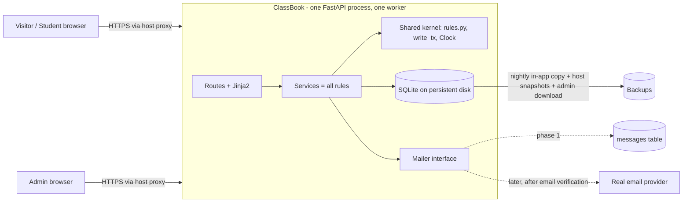

# Architecture: ClassBook

**Status:** see `status.md` (round 2)  ·  **Spec:** `docs/specs/classbook.md` (AGREED; one scope change pending, see section 11)

## Plain-language summary (for Maya)
- ClassBook is **one small program** that shows web pages and remembers data. One program is the cheapest and easiest thing to run and fix. (ADR-0001)
- Classes, students and bookings live in **one database file** (SQLite). The database itself acts as referee when two people grab the last spot, so a class can never be overbooked. "Spots left" is never stored; it is always capacity minus current bookings. (ADR-0002)
- Sign-in is email and password built from safe parts that ship with Python. You are created as the one admin from private settings. Your sign-in has no second step and no automatic reset: if you forget the password, your nephew Tom changes it in the host's settings page (you accepted this risk, AR-1 in the threat model). (ADR-0003)
- Confirmation emails go through a "mailer" that only writes messages down for now. An email problem can never undo a booking. Real email will not be switched on until sign-ups are verified. (ADR-0004)
- Next month's classes are **listed greyed out** with "Opens for booking on <date>", as you asked. Students can book only classes starting within 30 days.
- It will run on **Render** (a hosting company) as one small paid service with a small disk, about 6 pounds a month, well under your 10 pound ceiling. Exact steps for you are in ADR-0005. (ADR-0005)

## 1. Context & scope

In scope: spec phase 1 plus the pending scope change (section 11). Out: payments, waitlists, reminders, real mail, extra admins.

## 2. Components & responsibilities
| Component | Responsibility | Talks to |
|---|---|---|
| `routes/` | HTTP only: parse input, call a service, render or redirect. No rules. | services |
| `services/` (accounts, classes, bookings) | Business rules and ownership checks. Import the shared kernel; never re-implement it. | kernel, db, mailer |
| **`kernel/` (shared, built first in T1)** | `rules.py`: `is_bookable(cls, now)` (the one 30-day predicate), `opens_at(cls)`, `cancel_allowed(cls, now)`, `spots_left` SQL; `timeutil.py`: `Clock`, UTC/London conversion and parsing; `db.write_tx()`; limits and validators | db |
| `web/` (T2) | Base template, `csrf_field()` helper + middleware, flash messages, security headers, request-id logging, body-size limit | – |
| `auth/` | Password hashing, sessions, `current_user`/`require_student`/`require_admin`, throttle, admin bootstrap | db |
| `mail/` | `Mailer` protocol, `RecordingMailer`, plain-text templates | db |
| `config` | Env read and validation at startup (fail fast, no secrets echoed) | env |
Communication is plain function calls in one process. No queue, no second service.

## 3. Data model & storage
SQLite via stdlib `sqlite3`, parameterised SQL only. Instants stored as UTC ISO-8601 text. Migrations: numbered SQL files, applied in order in a transaction at startup, recorded in `schema_version`; additive only; a backup copy is taken before any pending migration runs.
**Pragmas (same in production and in tests):** `journal_mode=WAL`, `synchronous=FULL`, `foreign_keys=ON`, `busy_timeout=5000`. WAL requires a local disk (not a network share).
**Write transactions:** `kernel.db.write_tx()` opens the connection with `isolation_level=None` (autocommit, so Python never opens a hidden transaction) and issues `BEGIN IMMEDIATE`, so waiting for the write lock obeys `busy_timeout` (a read-then-write started as a plain transaction would fail instantly with "database is locked" in WAL). On timeout the request answers 503. `now` is read **once, after the lock is held**, and used for every comparison in that request.

| Table | Columns (key points) |
|---|---|
| `users` | id, email (unique, lowercase), name, password_hash (versioned prefix), role CHECK IN ('student','admin'), created_at, last_login_at, prev_login_at. **Partial unique index on `role` WHERE `role='admin'`**: at most one admin. |
| `sessions` | token_hash (PK, SHA-256), user_id FK, created_at, expires_at. Expired rows purged at startup and daily. |
| `classes` | id, title, starts_at (UTC), duration_min, instructor, capacity CHECK >=1, status CHECK IN ('active','cancelled'), created_at |
| `bookings` | id, class_id FK, user_id FK, status CHECK IN ('booked','cancelled'), cancelled_by CHECK IN ('student','studio') NULL, created_at, cancelled_at. **Partial unique index** `(class_id,user_id) WHERE status='booked'`. Indexes `(class_id,status)`, `(user_id,status)`. |
| `messages` | id, to_email, subject, body, kind, booking_id, status ('pending','recorded','failed'), created_at; unique `(booking_id, kind)` |
| `login_failures` | key (e.g. `email:x`, `ip:y`), at (UTC). Counters survive restarts; old rows purged daily. |
Spots left = `capacity - COUNT(bookings booked)` (one query, in `kernel/rules.py`). Rebooking after a cancel inserts a new row.
**Time rules:** "30 days" = exactly 30x24 hours from `now` in UTC (not calendar days, so DST cannot move it). Bookable iff class `active` and `now < starts_at <= now+30d`. Cancel allowed iff `starts_at - now >= 12h`. Admin-entered London local times: a time that does not exist (spring-forward gap) is rejected with a message; an ambiguous time (autumn fold) takes the first occurrence. Create and edit reject a start in the past.
**Input limits (kernel validators):** name 80, email 254 plus basic shape check, title 100, instructor 80, capacity 1..200, duration 5..480 minutes, password 10..128 (admin env password >= 14); control characters (including newlines) rejected in name/title/instructor; request body max 16 KB.

## 4. API design principles
Server-rendered HTML (ADR-0001), contract in `api.md`. Post/Redirect/Get; errors re-render with a 4xx. **Rule order is fixed** (api.md): book = unknown -> cancelled/started -> too far ahead -> already booked (no-op) -> full; cancel = not mine (404) -> already cancelled (no-op) -> too late. No pagination (listing horizon is 60 days, about 170 classes at most at 20/week). Unversioned URLs; a future JSON API would live under `/api/v1`.

## 5. Cross-cutting concerns
- **AuthN:** 256-bit random session token in cookie `__Host-session` when `APP_ENV=production` (plain `session` name locally), `HttpOnly`, `SameSite=Lax`, `Secure` iff `APP_ENV=production` (single switch), 14-day expiry, hashed in DB, new token at login, deleted at logout. Password: `hashlib.scrypt` N=2^14, r=8, p=1, per-user salt, `compare_digest`, versioned prefix; hashing/verifying happens **outside** any write transaction; unknown emails get a dummy verify so timing does not reveal accounts (ADR-0003).
- **Admin bootstrap (every startup):** (a) no admin exists: create from `ADMIN_EMAIL`/`ADMIN_PASSWORD`; if a student already has that email, refuse to start unless `ADMIN_PROMOTE_EXISTING=true`; (b) admin exists with a different email than `ADMIN_EMAIL`: refuse to start with a clear message unless `ADMIN_ALLOW_EMAIL_CHANGE=true`; (c) admin exists and the env password does not verify against the stored hash: the stored password is reset to the env value (this is the documented reset procedure, AR-1). `ADMIN_PASSWORD` shorter than 14 refuses to start.
- **AuthZ:** deny by default, server-side. Every route has exactly one declared guard (`public`, `require_student`, `require_admin`); the T7 test enumerates all routes and fails on any unguarded non-public route. Ownership in SQL (`user_id` from the session only); foreign resources answer 404.
- **CSRF (works before a session exists):** double-submit token. First GET of any page that has a form sets cookie `__Host-csrf` (plain `csrf` locally; random 256-bit, HttpOnly because the server embeds the value in each form). Every form contains `{{ csrf_field() }}`; every POST is rejected with 403 unless form value equals cookie (`compare_digest`). Token is rotated at login and logout. Plus SameSite=Lax. A T2 test scans every template: each `<form method=post>` must contain `csrf_field()`.
- **Client IP:** `TRUSTED_PROXY_HOPS=1` in production (Render adds the client IP as the right-most `X-Forwarded-For` entry); the app takes the entry that many positions from the right and ignores anything the client put further left. With hops=0 (local) it uses the socket address. 
- **Throttling (SQLite-backed):** login: 10 failures per 15 min per email (any IP) and 20 per 15 min per IP -> 429 "try again later"; sign-up: 10 per hour per IP; book/cancel: 20 actions per hour per user (caps email volume). The email cap means an attacker can delay Maya's logins for up to 15 minutes; accepted over the alternative of unlimited guessing (threat T-4).
- **Config (env only):** `APP_ENV`, `DATABASE_PATH`, `ADMIN_EMAIL`, `ADMIN_PASSWORD`, `ADMIN_PROMOTE_EXISTING?`, `ADMIN_ALLOW_EMAIL_CHANGE?`, `TRUSTED_PROXY_HOPS`, `MAIL_BACKEND` (`recording` only in phase 1; anything else refuses to start). No other secrets exist: backups use the host disk plus an admin download, so there are no storage credentials.
- **Headers:** `Content-Security-Policy: default-src 'self'`, `X-Content-Type-Options: nosniff`, `X-Frame-Options: DENY`, `Referrer-Policy: same-origin`, `Strict-Transport-Security` (production), `Cache-Control: no-store` on authenticated pages.
- **Logging/observability:** one-line JSON to stdout with request id (T1); never passwords, tokens, cookies or bodies; unhandled exceptions logged with request id and a generic 500 page. `/health` checks the DB. Uptime: a free external monitor pings `/health` and emails Maya; runbook says what she does (call Tom, section 9 of ADR-0005). Error-tracking service deferred (logs suffice at this size). Admin page shows "last sign-in" (previous successful login time and a count of failures since) so odd activity is visible.

## 6. Reliability
- Failure modes: lock timeout (503 page); disk loss (restore, below); mailer failure (booking unaffected, `messages.status='failed'`, error logged); restart (no in-memory state needed).
- Email: after commit the service inserts a `pending` message row, calls the mailer through `BackgroundTasks`, then sets `recorded` or `failed`. A crash in between loses at most one email (ADR-0004).
- Load: ~50 simultaneous bookers, millisecond transactions, serialised by the write lock; target p95 < 1 s.
- Backups (ADR-0005): in-app nightly `VACUUM INTO` copy on the same disk (7 kept), host daily disk snapshots, and an admin-only "Download backup" action for an off-site copy monthly. Restore rehearsed once (T8). Account deletion (GDPR-style, manual script run by Tom): deletes the user, their sessions and bookings (their spots are freed) and their `messages`; the person remains in older backups until those age out (about 7 days of snapshots plus any downloaded copies).
- Scaling: one instance only (the disk prevents more). Outgrowing it means managed Postgres (ADR-0002).

## 7. Security
See `threat-model.md`. Dependencies pinned; `pip-audit` and a secret scan in CI. Auth deviation from the capability is recorded in ADR-0003 with the principal-engineer's conditions adopted.

## 8. Testing strategy
| Level | What | Tooling | CI |
|---|---|---|---|
| Unit | kernel rules at boundaries (12h exact, day 30 and +1 s, DST gap/fold, 30x24h across a DST change), validators, scrypt, `next` validation, template scan for csrf fields | pytest | yes |
| Integration | Routes via TestClient on a real temp-file SQLite with the **production pragmas**; per-route auth checks; constraint rejects; migrations (empty DB and upgrade); mailer behaviour; bootstrap cases; throttle with spoofed forwarded headers | pytest + httpx | yes |
| Concurrency | 50 threads / own connections: 1 spot, 10 spots with 30 bookers, book vs cancel, lowering capacity vs booking | pytest | yes |
| Cross-task (T7) | Route-guard enumeration test, full authz matrix (anonymous / student / other student / admin on every route), booking race over **real HTTP against uvicorn**, journey test, a11y HTML checks | pytest + httpx + uvicorn | yes |
| Manual | keyboard and phone pass before release | – | no |
Test data via factories with injected `Clock`; only `RecordingMailer` exists.

## 9. Deployment & environments
Local and production (no preview; one studio). One Docker image built in CI from `main`; one uvicorn worker; DB on the persistent disk. Deploy button is human (Maya or Tom). Health check gates the deploy; rollback = redeploy previous image from the host dashboard; migrations additive; automatic pre-migration copy. Budget ceiling 10 GBP/month (ADR-0005). The host-account work is **blocked on human: Maya's host sign-up** and sits in T8; T8's first step can start as soon as T1 is merged so the disk assumption is proven early.

## 10. Risks, trade-offs, non-decisions
- R1 Single instance, no zero-downtime deploys: accepted.
- R2 Sign-up cannot fully hide that an email exists until verification exists.
- R3 One lost email on a crash after commit.
- R4 Host price/features are an ASSUMPTION until T8 verifies them at sign-up.
- R5 Admin without MFA/reset: named accepted risk AR-1 (threat model), accepted by Maya.
- R6 Editing a class start time does not notify students.
- R7 Real email stays off until sign-up verification exists (ADR-0004).
- Left out: queue/worker, ORM, SPA, JSON API, CDN, multi-admin, error-tracking service.

## 11. Scope change from review (F21) and spec impact
Classes starting more than 30 days away are now **listed, greyed, not bookable**, with "Opens for booking on <London date and time>" (= `starts_at - 30x24h`). Listing horizon `LISTING_HORIZON_DAYS=60` (ASSUMPTION; Maya said "next month"). Spec lines the requirements-analyst must update:
- **AC-1.1** (list also shows greyed classes up to 60 days ahead, ordered by start), **AC-1.2** (unchanged for started/cancelled; clarify that classes beyond 30 days are *not* excluded), add **AC-1.5** (class beyond 30 days shows disabled state and opens-on date/time, no Book action), **AC-3.6** second sentence ("not shown as bookable" becomes "shown but not bookable, with its opens-on date; direct booking refused with explanation"), **AC-3.7** (the label disappears and Book appears at the boundary without admin action), **AC-4.1 and AC-6.3** (My bookings also shows upcoming bookings cancelled by the studio, marked "cancelled by the studio"; still no email, Q5; F18), the Q1 line / NFR table (admin password minimum 14; accepted-risk note AR-1: no MFA/reset, Tom resets by hand), section 6 add Q8 (listing horizon 60 days).

## Review responses
Round 1, one entry per finding. "Fixed" means changed in the file named.
- **F1 Accepted.** Added `GET /classes/{id}` page (api.md #5); visitors see "Sign in to book" linking to `/login?next=/classes/{id}`; after login they land on that class and can book. Test in T4/T7 (visitor -> login -> class -> book).
- **F2 Accepted.** Double-submit CSRF cookie that works before a session (architecture s5); `csrf_field()` helper and scanning test are in T2; token rotated at login/logout; `csrf_token` column removed from `sessions`.
- **F3 Accepted.** Partial unique index for a single admin (s3); precise bootstrap rules (s5, cases a-c) with a test per case; password change in env resets admin password (documented reset, AR-1).
- **F4 Accepted.** Trusted-proxy rule via `TRUSTED_PROXY_HOPS` (s5); per-email cap added (any IP) plus per-IP cap; counters in SQLite (`login_failures`); sign-up throttle keyed on IP; spoofed-header test in T3. Residual: attacker can delay admin login for 15 min (threat T-4).
- **F5 Accepted.** `kernel/` (window predicate, spots-left, cutoff, time parsing, `write_tx()`, validators) and `web/` helpers (csrf, flash) are now T1/T2 and imported by later tasks; route-guard and authz-matrix tests are owned by T7 (work-breakdown).
- **F6 Accepted.** Task list restructured: T1 has Dockerfile, CI, health, JSON logging; host choice made (ADR-0005); T8 first step (deploy `/health` with a disk) can start right after T1; E2E/a11y moved to T7, ops/backups/runbook to T8. Host sign-up is marked blocked on human.
- **F7 Accepted.** ADR-0003 rewritten on the real reasons; scrypt parameters and 128-char cap fixed; hash outside transactions; dummy hash for unknown emails; versioned prefix; AR-1 named.
- **F8 Accepted.** Rule order fixed (s4, api.md); `now` read once after the lock (s3); tests in T4/T5.
- **F9 Accepted.** 30x24h definition, gap rejected, fold first occurrence, edit cannot move into the past (s3); tests in T1/T4.
- **F10 Accepted.** (a) pending->recorded/failed flow (s6, ADR-0004); (b) noted as part of outbox upgrade; (c) 20 book/cancel actions per hour per user; (d) control characters rejected; (e) real delivery forbidden until verification exists (ADR-0004, T-17, config refuses non-recording backend).
- **F11 Accepted.** Single `Secure` switch (`APP_ENV`), `__Host-` prefixes, purge of expired sessions, stricter `next` validation (api.md, T-9).
- **F12 Accepted.** Limits, email shape, normalisation and 16 KB body cap in s3; validators in T1; tests per limit.
- **F13 Accepted with a different shape.** No external storage credentials: in-app nightly `VACUUM INTO`, host snapshots and admin download (ADR-0005). Continuous replication (Litestream-style) **Deferred** because it needs external storage and a secret; revisit if data becomes more valuable. Deletion semantics defined (s6).
- **F14 Accepted.** External uptime monitor emails Maya; runbook line; unhandled-exception logging test (s5, T1/T8).
- **F15 Accepted.** Named as AR-1 in the threat model, shown to Maya (she accepted); admin password minimum 14; "last sign-in" note on admin page.
- **F16 Accepted, within 8 tasks.** T1 kernel/CI/Docker, T2 web shell, T3 accounts; throttle and bootstrap stay in T3 with a note to the developer to split the PR if over 400 lines but not the task. Real-HTTP race test in T7; tests use production pragmas (s3, s8).
- **F17 Accepted.** HSTS and Referrer-Policy added; WAL-needs-local-disk noted (s3, ADR-0005).
- **F18 Accepted (Maya: yes).** My bookings shows "cancelled by the studio" via `bookings.cancelled_by`; no email.
- **F19 Answered by Maya, decision recorded.** Render, up to 10 GBP/month (ADR-0005 with a step list for Maya).
- **F20 Answered by Maya: accepted.** AR-1 recorded; reset by Tom through `ADMIN_PASSWORD` (runbook).
- **F21 Answered by Maya: list greyed with opens-on date.** Design/API changed (s11, api.md #1/#5); spec lines to update listed in s11.
